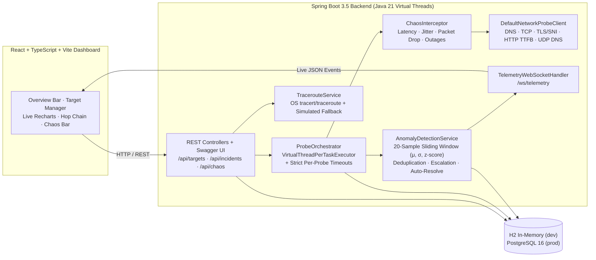

# NetPulse — Distributed Network Telemetry, Synthetic Monitoring & Anomaly-Detection Platform

**NetPulse** is a full-stack, Windows- and Linux-compatible synthetic network monitoring and real-time observability platform built with **Java 21 Virtual Threads**, **Spring Boot 3.5**, **WebSockets**, and **React + TypeScript + Tailwind + Recharts**.

It continuously probes multi-protocol endpoints (`HTTPS`, `HTTP`, `TCP`, `DNS`) concurrently, breaks down per-stage network timings (DNS, TCP 3-way handshake, TLS handshake + certificate expiry, HTTP TTFB, packet loss, and jitter), detects anomalies using a rolling 20-sample z-score window, manages deduplicated incidents with auto-recovery, and streams live updates over WebSockets to an interactive observability dashboard with a built-in **Chaos Fault-Injection Simulator**.

---

## Architecture Overview



---

## Key Features

- **Multi-Protocol Concurrent Prober:** Uses `Executors.newVirtualThreadPerTaskExecutor()` with per-target interval tracking, in-flight deduplication, and strict hard timeouts (`timeoutMs + 2500ms`) so hung hosts never stall sibling probes.
- **Granular Network Timing Breakdown:**
  - **DNS Resolution:** `InetAddress.getAllByName` lookup duration + resolved IPv4 preference.
  - **TCP Connect:** Exact 3-way handshake duration via `Socket.connect`.
  - **HTTPS / TLS:** SNI-enabled `SSLSocket` handshake timing, X.509 certificate `tlsCertDaysRemaining`, HTTP status code, and exact Time-to-First-Byte (`ttfbMs`).
  - **DNS Server Checks:** Raw UDP DNS A-record query packets over `DatagramSocket` (with TCP port 53 fallback).
  - **Packet Loss & Jitter:** 3 rapid reachability attempts per cycle computing loss % and mean consecutive RTT delta (jitter).
- **OS-Aware Hop-by-Hop Path Inspector:** Runs `tracert -d -h 12 -w 1000` (Windows) or `traceroute -n -m 12 -w 1` (Linux) asynchronously on a virtual thread, parses hop IP/RTT/timeouts into structured JSON, and falls back to a deterministic simulated path for offline demos or loopback targets.
- **Rolling-Window Anomaly & Incident Engine:**
  - Maintains a thread-safe 20-sample healthy sliding window per target (seeded lazily from DB on restart).
  - Evaluates dynamic rules:
    | Severity | Trigger Condition |
    | :--- | :--- |
    | `WARNING` | Latency $> \mu + 2\sigma$, OR packet loss $\ge 20\%$, OR TLS cert expires in $< 14$ days |
    | `CRITICAL` | Latency $> \mu + 3\sigma$, OR packet loss $\ge 50\%$, OR 2 consecutive probe failures |
  - Deduplicates repeated alerts into a single active incident, escalates `WARNING` → `CRITICAL`, records peak metrics (`peakLatencyMs`, `peakPacketLossPct`, `peakZScore`), and auto-resolves after **3 consecutive healthy cycles**.
- **Application-Layer Chaos Simulator:** Inject latency spikes (`+300ms`), jitter, packet drops (`40%`), forced DNS failures (`NXDOMAIN`), or timeouts via REST or one-click dashboard buttons—no admin privileges, Npcap, or Linux `tc netem` required.
- **Instant Live Startup:** Pre-seeds 6 targets (`Local Mock Target` at `/api/mock-target`, `cloudflare.com`, `google.com`, `github.com`, `1.1.1.1:443`, and `8.8.8.8:53`).

---

## REST & WebSocket API Reference

Interactive Swagger UI is available at **http://localhost:8080/swagger-ui.html** (OpenAPI JSON at `/v3/api-docs`).

| Method | Endpoint | Description |
| :--- | :--- | :--- |
| `GET` | `/api/overview` | Fleet health summary (active/healthy/degraded/down counts, global avg latency, open incidents) |
| `GET` | `/api/targets` | List all monitored targets with status, chaos flag, and open incident count |
| `POST` | `/api/targets` | Create a new target (`HTTPS`, `HTTP`, `TCP`, `DNS`) |
| `PUT` | `/api/targets/{id}` | Update target host, port, protocol, interval, or timeout |
| `PATCH` | `/api/targets/{id}/toggle` | Pause or resume probing for a target |
| `DELETE` | `/api/targets/{id}` | Delete target and cascade-clean probes, incidents, chaos rules, and sliding window |
| `GET` | `/api/targets/{id}/probes?limit=50` | Recent probe history with rolling $\mu$, $\sigma$, and z-score |
| `POST` | `/api/targets/{id}/probe` | Trigger an immediate on-demand probe |
| `GET` | `/api/targets/{id}/traceroute?simulate=false` | Run OS traceroute (or deterministic simulated path when `simulate=true`) |
| `GET` | `/api/incidents?status=OPEN&targetId=...` | List active or historical incidents |
| `GET` | `/api/chaos` | List active chaos fault-injection rules |
| `POST` | `/api/chaos/{targetId}` | Upsert synthetic latency, jitter, packet drop, DNS failure, or timeout rule |
| `DELETE` | `/api/chaos/{targetId}` | Clear active chaos rule for a target |
| `GET` | `/api/mock-target` | Built-in local synthetic HTTP target (`200 OK`) |
| `WS` | `/ws/telemetry` | Live JSON event stream (`CONNECTED`, `PROBE_RESULT`, `TARGET_UPDATED`, `INCIDENT_OPENED`, `INCIDENT_UPDATED`, `INCIDENT_RESOLVED`, `OVERVIEW_UPDATED`) |

---

## Local Quick Start (Windows)

### Prerequisites
- **Java 21+** (tested on Java 21 and Java 25; Maven Wrapper `mvnw.cmd` is included—no global Maven install required)
- **Node.js 20+** and **npm**

### 1. Run the Backend (H2 `dev` profile)
```cmd
cd backend
mvnw.cmd spring-boot:run
```
- API & Swagger UI: http://localhost:8080/swagger-ui.html
- H2 Console: http://localhost:8080/h2-console (JDBC URL: `jdbc:h2:mem:netpulse`, User: `sa`, Password: *(empty)*)

### 2. Run the Frontend (Vite Dev Server with API + WebSocket Proxy)
Open a second terminal:
```cmd
cd frontend
npm install
npm run dev
```
- Open the live dashboard at **http://localhost:5173**

### 3. Run Automated Tests & Production Builds
```cmd
:: Backend unit & integration tests (26 JUnit 5 + Mockito + WebSocket tests)
cd backend && mvnw.cmd clean test

:: Frontend TypeScript check & Vite production bundle
cd frontend && npm run build
```

---

## Running with Docker Compose (PostgreSQL `prod` Profile)

```cmd
docker compose up --build
```
- **Dashboard:** http://localhost:3000 (Nginx serves the SPA and proxies `/api` + `/ws` to `backend:8080`)
- **Backend API / Swagger:** http://localhost:8080/swagger-ui.html
- **PostgreSQL 16:** `localhost:5432` (`netpulse` / `netpulse_secret`)

---

## Free Cloud Deployment on Render ($0/month)

This repository includes a single-container root [Dockerfile](Dockerfile) and [render.yaml](render.yaml) Blueprint that bundle the React dashboard into Spring Boot so UI, REST APIs, Swagger UI, and WebSockets all run on one free service with zero CORS setup:

1. Sign in to [Render](https://dashboard.render.com) with GitHub.
2. Click **New + → Blueprint**, select **`Chandu1133/netpulse`**, and click **Apply**.
3. Wait ~3–5 minutes for the Docker build to finish, then open your live `https://<service>.onrender.com` URL (Swagger UI is at `/swagger-ui.html`).

*(Note: Render's free tier sleeps after 15 minutes of inactivity and wakes up in ~30–50 seconds on the next visit.)*

---

## 60-Second Live Chaos Demo Walkthrough

1. Open **http://localhost:5173** and confirm the **Live WS Stream** pill is green.
2. Select **Local Mock Target** (or **Cloudflare**) and let 3+ healthy baseline probes complete (or click the target's refresh icon 3 times).
3. Click **Latency Spike (+300ms)** in the **Chaos Control Bar**:
   - The latency chart immediately spikes above the $\mu + 3\sigma$ threshold band.
   - A `CRITICAL` `LATENCY_SPIKE` incident opens in the **Incident Log** with exact z-score and root cause.
4. Click **Clear Chaos** and let 3 healthy probes complete (or click Probe Now 3 times):
   - The open incident automatically transitions to `RESOLVED` with `resolvedAt` and preserved peak latency/z-score.
5. Click **Live Traceroute** or **Simulated Demo** in the **Hop-by-Hop Path Inspector** to visualize network hops.

---

## Concurrency, Performance & Design Trade-Offs

1. **Java 21 Virtual Threads vs. Platform Thread Pools / WebFlux:**
   - Network probing is overwhelmingly blocking I/O (`InetAddress.getAllByName`, `Socket.connect`, TLS handshakes, `Process.waitFor`). Using `Executors.newVirtualThreadPerTaskExecutor()` lets NetPulse fan out hundreds or thousands of concurrent probes using straightforward, debuggable imperative socket code without starving OS carrier threads or paying the complexity cost of reactive pipelines.
   - Each probe runs inside an isolated `Future.get(timeoutMs + 2500ms)` boundary plus an `inFlightTargets` guard set, guaranteeing slow/unresponsive hosts cannot block sibling probes or pile up overlapping runs.
2. **Socket-Level HTTP/TLS Instrumentation vs. `java.net.http.HttpClient`:**
   - High-level HTTP clients hide DNS, TCP connect, TLS handshake, and TTFB behind a single aggregate latency number. Implementing probing directly on `Socket` + SNI-configured `SSLSocket` exposes exact per-phase timings and X.509 peer certificate expiry in a single round-trip while staying 100% pure JDK (zero native/raw-socket privileges required on Windows).
3. **Sliding-Window Effective Standard Deviation Floor ($\sigma_{\text{eff}}$):**
   - Ultra-stable local targets (e.g., `localhost` at `1.2ms ± 0.05ms`) produce near-zero variance, which causes naive z-score formulas to false-alarm on sub-millisecond GC jitter. NetPulse applies a small floor ($\sigma_{\text{eff}} = \max(\sigma, \max(0.05\mu, 5\text{ms}))$) and excludes anomalous/failed probes from the healthy baseline window so real spikes stay visible while localhost stays calm.
4. **Raw Spring WebSocket (`/ws/telemetry`) vs. STOMP/SockJS:**
   - A typed JSON event envelope over native `WebSocket` avoids heavy broker/polyfill dependencies in Vite/TypeScript, works cleanly through standard Nginx/Vite HTTP upgrade proxies, and uses per-session synchronization in `TelemetryWebSocketHandler` so concurrent virtual threads safely broadcast without `IllegalStateException` frame collisions.
5. **Application-Layer Chaos Interceptor vs. OS Fault Injection (`tc netem`):**
   - Intercepting probes in-process via `ChaosInterceptor` (pre-probe short-circuiting for DNS/timeout outages; post-probe injection for latency/jitter/packet drop) gives deterministic, per-target fault simulation on Windows, macOS, and unprivileged Docker containers alike.
